<div align="center">



</div>

<br/>

Comecei como **dev**: sites, landing pages, sistemas com banco de dados, um projeto atrás do outro.
No meio do caminho esbarrei em **IA** e me apaixonei. Hoje junto as duas coisas como dev de **IA Generativa** na consultoria de tecnologia da **IBM Brasil**: construo agentes, os pipelines que alimentam as bases de conhecimento deles e, quando algo quebra em produção, abro os traces e sigo o rastro até a causa raiz.

> Meu momento favorito no trabalho é quando algo que **"funciona"** não deveria estar funcionando.
> Uma vez achei um teste que passava só por acaso — e foi aí que entendi que o que eu gosto mesmo é de descobrir **o porquê** das coisas. 🦇

<div align="center">

</div>

<br/>


<div align="center">

</div>

A base de dev é o que me faz diferente na IA: eu não só escrevo prompts — eu construo o pipeline, o backend e a automação em volta deles.


Bugs de LLM em produção não aparecem no stack trace. Alguns que já derrotei:

| 👾 Boss | O que estava acontecendo | Golpe final |
|---|---|---|
| **O Teste Sortudo** | Um teste "passava" só porque um trecho concorrente não chegava ao contexto | 4 traces, 3 cenários, 4 causas raiz sobrepostas — e o falso positivo desmascarado |
| **O Roteador Esquecido** | No 2º turno o roteador repassava só a continuação, sem a pergunta original | Rastreei o que o especialista realmente recebia |
| **A Brevidade Tirana** | A regra "seja breve" vencia a de completude e descartava alertas importantes | 3 iterações de prompt + validação em cada ambiente |
| **A Resposta Escondida** | O conteúdo existia na base, mas só era achado com as palavras exatas do manual | Diagnóstico de *semantic mismatch* comparando dois traces |


<div align="center">

**⚔️ dev**<br/>


**🔮 magia (IA)**<br/>


**💎 itens raros**<br/>


</div>


<table>
<tr>
<td width="50%" valign="top">

### 🧠 [MindED](https://github.com/Ikaterin-ctrl/MindED)
Sou neurodivergente e passei boa parte da escola tentando aprender num sistema que ensina todo mundo igual. O MindED existe pra que outros estudantes não passem por isso sozinhos: reestrutura textos complexos, quebra conteúdo em microtarefas e gera analogias sob controle.

`Python` `FastAPI` `Pydantic v2` `LLMs`

</td>
<td width="50%" valign="top">

### 🔍 Como eu caço bugs de LLM
```
1. reproduzir em dev e homologação
2. comparar traces (tools, chunks, msgs)
3. diff de system prompts entre ambientes
4. corrigir → retestar → checar regressão
5. triar: é o agente ou é a base?
```

</td>
</tr>
</table>


<div align="center">

</div>


<div align="center">

Bora conversar sobre **dev**, **agentes em produção**, **qualidade de RAG** ou **IA que deixa o aprendizado mais acessível**.

<a href="https://www.linkedin.com/in/catarina-costa-774950350"></a>
<a href="mailto:catarinacostaandradecom@gmail.com"></a>

<br/><br/>


</div>
